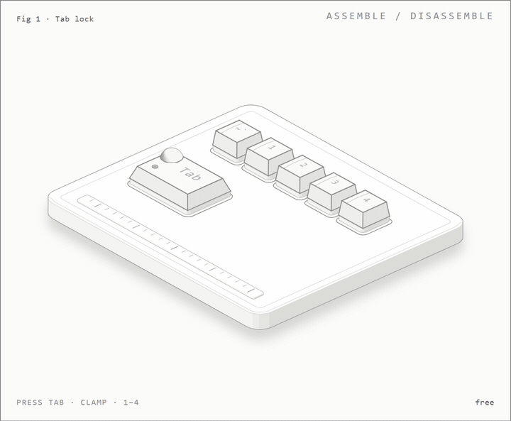

# TTBuddyAI (AutoHotkey)

> **TL;DR:** Your keyboard sidekick. An AHK script that moves all critical editing controls to the top row (`Tab` + Numbers/Letters).

## 👀 A concept picture (not part of the script)

  

A concept animation. It is not a recording of the script.

The script itself is simple: you hold `Tab` with your own finger and tap a top-row key. `Tab` + `1` is Copy. You don't need a clamp, extra buttons or any hardware, just the `.ahk` file.

The picture above is a different thing. While I was thinking about this idea I sketched a concept keyboard where a small mechanical clamp holds `Tab` down, so the top row stays switched to Copy, Paste, Cut and Select All. I made it because a table of hotkeys is dull to read, and it's easier to picture the idea when you can see the keys move.

It's only a prototype drawing. Nothing like it ships with this repo, and there is no device you can buy or touch. If you want to build real key movements on the same idea, go for it, but that is a separate project.

## ☕ The "Why"
Meet **TTBuddyAI**. This little AutoHotkey gizmo helps you copy, paste, and edit super fast using just the top row and `Tab`. No need for `Ctrl`, `Alt`, or `Shift` ever again.

It is perfect for late-night coding when you’re tired, the room is dark, and you just want things to be easy. It works even if you’ve got a coffee in one hand and just want life to be a little simpler.

**What’s Cool:**
*   **One-handed control:** Everything happens with `Tab` + the top row.
*   **Relaxed workflow:** Forget finger gymnastics. This script is for relaxed pros.
*   **Safety:** `Alt+F4` is remapped so you don't accidentally close your work when aiming for other keys.

---

## 🤔 A Note from the Author
*So, what did you expect? This isn’t some secret cipher or cutting‑edge data compression — it’s just plain, old‑fashioned shortening. Sigh.*

This isn’t about flexing your copy‑paste skills; it’s about fixing the frustration of stagnant workflows. Forums around major AI platforms are absolute gold mines of fresh solutions that pop up way before they hit official pages.

**You’re professionals, right?** Stop grabbing only what’s ready‑made: take a chance, actually talk to people. Real exchange — that’s where “balance” happens, not in kilobytes. Speed? Can’t live without it. But let's add some thought to it.

---

## ⌨️ Hotkeys Cheat Sheet

| Combo | Action | Notes |
| :--- | :--- | :--- |
| **Tab + 1** | Copy | `Ctrl+C` |
| **Tab + 2** | Paste | `Ctrl+V` |
| **Tab + 3** | Cut | `Ctrl+X` |
| **Tab + 4** | Select All | `Ctrl+A` |
| **Tab + Q** | Delete Left | Like `Backspace` |
| **Tab + W** | Delete Right | Like `Delete` |
| **Tab + Z** | Undo | `Ctrl+Z` |
| **Tab + S / D** | Shift + Enter | New line (soft return) |
| **Tab + G / H** | Enter | Hard return |
| **Tab + E / R** | Select Letter | Left / Right |
| **Tab + C / V** | Select Word | Left / Right |

### 🛡️ System Controls
*   **Alt + F4** → `F11` (Safety feature: prevents accidental closing).
*   **ScrollLock** → **Pause Script** (Use this when you need the normal `Tab` key or `Alt+Tab`).
*   **Ctrl+Alt+Shift+Win+F12** → **Emergency Exit** (Kills the script instantly).

---

## 🚀 How to Roll (Usage)

1.  **Install:** Get [AutoHotkey](https://www.autohotkey.com/) (v1.1 or v2.0).
2.  **Run:** Double-click `TTBuddyAI.ahk`.
3.  **Workflow:**
    *   Hold `Tab` with your left pinky/ring finger.
    *   Tap `1` to Copy.
    *   Switch windows.
    *   Tap `2` to Paste.
    *   Tap `S` if you want a line break but don’t want to send the message yet.

**Best used when:**
*   Editing text or code like a ninja.
*   Swapping stuff between windows/files rapidly.
*   You are in "easy mode" (tired, drinking coffee, or just lazy).

## License
Free to use and tweak — just say who made it!

---
*Maintained by Aleksandrs M. Orrin.*

